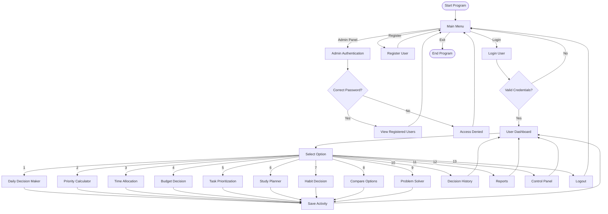

# 🚀 Personal Decision & Problem Solver Suite

A console-based C++ application that helps users make smarter decisions, manage daily tasks, solve problems, plan studies, track habits, and organize personal activities. The system includes user authentication, activity tracking, and an admin panel.

---

## 📖 Overview

The **Personal Decision & Problem Solver Suite** is designed to assist students and individuals in making better decisions through a simple menu-driven interface.

Users can:

- Register and log in
- Manage daily decisions
- Prioritize tasks
- Plan study schedules
- Track habits
- Analyze budgets
- Compare options
- Solve personal problems
- View activity history

---

## ✨ Features

### 🔐 Authentication System

- User Registration
- User Login
- Duplicate Username Detection
- Admin Panel Access
- Activity Tracking
- Logout System

### 🧠 Decision-Making Tools

| No. | Feature |
|------|----------|
| 1 | Daily Decision Maker |
| 2 | Priority Calculator |
| 3 | Time Allocation |
| 4 | Budget Decision |
| 5 | Task Prioritization |
| 6 | Study Planner |
| 7 | Habit Decision |
| 8 | Compare Options |
| 9 | Problem Solver |
| 10 | Decision History |
| 11 | Reports |
| 12 | Control Panel |
| 13 | Exit |

---

## 🛠 Built With

- C++
- Standard Template Library (STL)
- Vector
- Structures
- Functions
- Conditional Statements
- Loops

---

## 📊 System Flowchart



---

## 📂 Project Structure

```text
Personal-Decision-Solver/
│
├── main.cpp
├── README.md
└── screenshots/
```

---

## 📋 Main Menu

```text
===================================
 DECISION & PROBLEM SOLVER SUITE
===================================

1. Login
2. Register
3. Admin Panel
4. Exit App
```

---

## 📋 User Dashboard

```text
1. Daily Decision Maker
2. Priority Calculator
3. Time Allocation
4. Budget Decision
5. Task Prioritization
6. Study Planner
7. Habit Decision
8. Compare Options
9. Problem Solver
10. Decision History
11. Reports
12. Control Panel
13. Exit
```

---

## 🔍 Feature Details

### 1️⃣ Daily Decision Maker

Suggests whether the user should:

- Study
- Rest

Based on:
- Exam deadline
- Energy level

---

### 2️⃣ Priority Calculator

Calculates:

```text
Priority Score = Urgency × Importance
```

Priority levels:

- High Priority
- Medium Priority
- Low Priority

---

### 3️⃣ Time Allocation

Helps users distribute:

- Study Time
- Sleep Time
- Chore Time

Within a 24-hour schedule.

---

### 4️⃣ Budget Decision

Determines whether purchasing an item is financially reasonable based on the user's monthly budget.

---

### 5️⃣ Task Prioritization

Compares two tasks and displays the task that should be completed first.

---

### 6️⃣ Study Planner

Calculates:

```text
Chapters Per Day = Total Chapters ÷ Remaining Days
```

---

### 7️⃣ Habit Decision

Evaluates weekly consistency and encourages improvement.

---

### 8️⃣ Compare Options

Compares two options using ratings and recommends the better choice.

---

### 9️⃣ Problem Solver

Provides guidance depending on whether a problem is:

- Under your control
- Outside your control

---

### 🔟 Decision History

Displays previously used tools and activities.

---

### 1️⃣1️⃣ Reports

Shows:

- Active User
- System Status
- Total Registered Users

---

### 1️⃣2️⃣ Control Panel

Displays:

- System Version
- Security Information

---

## ▶️ How to Run

### Compile

```bash
g++ main.cpp -o decision_solver
```

### Run

Linux/Mac:

```bash
./decision_solver
```

Windows:

```bash
decision_solver.exe
```

---

## 🔮 Future Improvements

- File Handling
- Data Persistence
- Password Encryption
- Input Validation
- Database Integration
- GUI Version
- Web Application Version
- User Analytics Dashboard

---

## 🎓 Learning Outcomes

This project demonstrates:

- C++ Programming
- Structs
- Vectors
- Authentication System
- Activity Tracking
- Menu-Driven Applications
- Decision-Making Algorithms
- Problem-Solving Logic

---

## 👨‍💻 Author

**Rifat**

### Project
**Personal Decision & Problem Solver Suite**

---

⭐ If you found this project useful, don't forget to **Star** the repository!
