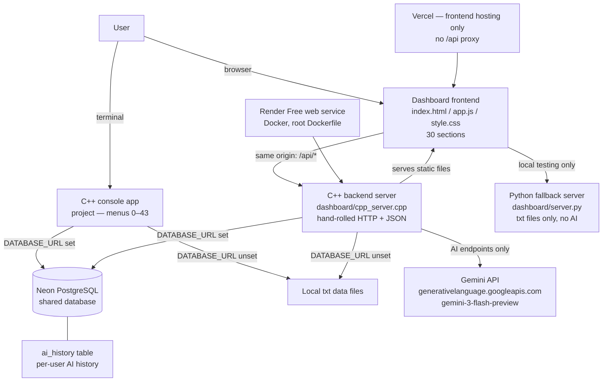

# System Architecture — Personal Decision & Problem Solver

**Project:** Personal Decision & Problem Solver — a team OOP project (C++17) that helps
users make daily decisions, manage tasks, track money and habits, and get AI advice.

**Branch documented:** `phase4-backend-integration` (from `main` at `c698060`, the
PR #66 Gemini merge). **Status: the Render deployment is BLOCKED** — a live
attempt on 2026-11-09 demanded a credit/debit card at Free service creation,
so no Render service exists (no card was added, no charge). The demo runs on
the local server (`http://127.0.0.1:8000/`). Where a fact is not yet
verified, it is marked **TBD**.

## 1. Overview

The system has four parts that share one database:

1. **C++ console app** (`project`) — the original menu-driven program (menus 0–43).
2. **C++ backend server** (`dashboard/cpp_server.cpp`) — serves the dashboard and the
   full REST API, including the Gemini AI endpoints.
3. **Python fallback server** (`dashboard/server.py`) — the same API over plain-text
   files, used for local testing and as a fallback. It has no AI and no Postgres.
4. **Dashboard frontend** (`dashboard/index.html`, `app.js`, `style.css`) — 30 sections,
   served as static files by the C++ server.

Console and website read and write the **same online PostgreSQL database (Neon)**,
so a decision saved in the console appears on the website and vice versa.



## 2. Components

| Component | File(s) | Language | Role | Verified facts |
|---|---|---|---|---|
| Console app | `main.cpp`, `*.cpp` / `*.h` (root), `console_pg.h` | C++17 | Menu-driven program, menus 0–43 (register, login, decisions, tasks, budget, habits, reports, backup/restore, problem solver, multi-task) | Built by `make` (`project` target). Postgres layer in `console_pg.h` reuses the server's `dashboard/pg_store.h` DDL — no schema is duplicated. |
| C++ backend server | `dashboard/cpp_server.cpp` (2,748 lines), `dashboard/pg_store.h`, `dashboard/gemini_client.h` / `.cpp` | C++17 | Serves the dashboard static files and the full REST API (auth, data, AI). The only server that calls Gemini. | Hand-rolled HTTP over raw sockets; hand-rolled JSON; static serving limited to `index.html`, `style.css`, `app.js`; request bodies capped at 1 MiB (larger → 413). |
| Python fallback server | `dashboard/server.py` (1,175 lines) | Python 3 | Same data API over txt files for local testing | txt-only by design. Any `/api/ai/*` request returns **501 `{"error":"AI requires the C++ server"}`** (after the 401 auth check). Its `/api/health` reports `{"backend":"Python","storage":"txt"}`. |
| Dashboard frontend | `dashboard/index.html` (601 lines), `dashboard/app.js` (1,482 lines), `dashboard/style.css` (305 lines) | HTML / JS / CSS | 30 sections incl. 7 AI sections (`ai-daily`, `ai-task`, `ai-study`, `ai-problem`, `ai-budget`, `ai-habit`, `ai-history`) | `API_BASE` comes from `window.PDPS_API_BASE` (default `""` = same origin). Public sections are only `landing` and `auth`; every other section redirects to login when logged out. Mobile-responsive (drawer sidebar under 720 px). |
| PostgreSQL (Neon) | `dashboard/schema.sql`, `dashboard/pg_store.h` | SQL | Shared online database for console + website | 10 tables, auto-created at startup (`CREATE TABLE IF NOT EXISTS`): `users`, `decisions`, `decisions_backup`, `tasks`, `transactions`, `savings_goals`, `habit_log`, `daily_reports`, `error_logs`, `ai_history`. All queries use parameterised `PQexecParams`. |
| Gemini AI client | `dashboard/gemini_client.h` / `.cpp` (356 lines) | C++17 + libcurl | Calls the Gemini API from the C++ backend only | Key read fresh per call from `GEMINI_API_KEY`, sent only as the `x-goog-api-key` header, never in a URL, log, error, or response. Connect timeout 10 s; total timeout `GEMINI_TIMEOUT_SECS` (clamped 1–120, default 30); 1 MiB response cap; 8,000-character prompt budget (UTF-8 code points). libcurl is opt-in — without it the client is a stub and every AI endpoint answers 503. |
| Render hosting | `Dockerfile` (repo root), `render.yaml` (template) | Docker | Runs the C++ server in production | Debian `bookworm-slim`; installs g++, `libpq-dev`, `libcurl4-openssl-dev`; compiles `cpp_server.cpp` + `gemini_client.cpp` with `-lpq` and curl flags; command `cpp_server --host 0.0.0.0 --port ${PORT:-8000}`. `render.yaml` declares service `pdps-cpp-backend`, plan `free`, health check `/api/health`; `DATABASE_URL` and `CORS_ORIGINS` are set in the Render dashboard only, never in the file. **BLOCKED: Render demands a card at Free service creation (verified live 2026-11-09); no service exists.** |
| Vercel frontend hosting | `vercel.json` | — | Hosts the dashboard frontend | Rewrites `/`, `/index.html`, `/style.css`, `/app.js` to the dashboard files. **There is NO `/api` rewrite**, so the Vercel site cannot reach the backend. The live demo URL is the Render service URL, which serves the dashboard and the API from one origin. |

## 3. Data flow

### 3.1 A dashboard request (e.g. saving a task)

```
Browser (dashboard, same origin)
  → GET /  →  C++ server serves dashboard/index.html
  → login: POST /api/login {username, password}
       → PBKDF2 password check → in-memory session token (12 h)
       → response {"token": "..."} (stored in sessionStorage)
  → POST /api/tasks  Authorization: Bearer <token>
       → auth guard: no valid session → 401 "Please log in first."
       → validation: title non-empty, urgency/importance 1–10,
         deadline a real YYYY-MM-DD date or blank
       → Postgres mode: INSERT INTO tasks (...) VALUES ($1..$6)
         with owner = <username>
         (txt mode: append one pipe-delimited line to tasks.txt)
       → 201 {"id","title","urgency","importance","deadline","status","score"}
  → GET /api/tasks → only rows where ownerVisible(owner, caller) is true
```

### 3.2 A console action (e.g. registering and saving a decision)

```
Terminal: ./project
  → startup: initStorage()
       → DATABASE_URL set: connect to Neon, create missing tables
         (same DDL as the server); unreachable DB → fail fast, exit 1,
         NO silent fallback to txt files
       → DATABASE_URL unset: local txt files, exactly as before
  → menu 1 Register: first registered user becomes ADMIN,
     later users become USER; password stored as a PBKDF2 hash
  → menu 9 Daily Decision: score = urgency×2 + importance×3
       → console_pg.h writes the decision row to the same Neon
         `decisions` table the website reads (owner = current user)
  → the same decision is immediately visible at GET /api/decisions
    on the website, and a task created on the website is visible
    in console menu 13 (Task Status)
```

### 3.3 An AI request (e.g. Daily Decision Assistant)

```
Dashboard AI section
  → POST /api/ai/daily-decision  Authorization: Bearer <token>
       → auth guard (401 without a session)
       → validation: input required, ≤ 4,000 bytes;
         options optional, ≤ 10, each ≤ 500 bytes
       → fixed server-side instruction + user input as quoted DATA
         (user input is never treated as an instruction)
       → gemini_client.generate(prompt)
            → POST https://generativelanguage.googleapis.com/v1beta/models/
              gemini-3-flash-preview:generateContent
              with header x-goog-api-key: <key from GEMINI_API_KEY>
       → on success: save {feature, prompt, response, owner} to ai_history
         (2.3–2.6 verify the row landed — read-back — before replying;
          a failed save is a 502, never a false 200)
       → 200 {"reply": "...", "history_id": <n>}
       → on failure: mapped error (see §5)
```

## 4. Storage

Two modes, chosen only by the `DATABASE_URL` environment variable:

| | Postgres mode (`DATABASE_URL` set) | txt mode (`DATABASE_URL` unset) |
|---|---|---|
| Used by | Render production, console with the env var set | Local development, Python fallback server |
| Tables / files | 10 Neon tables (see §2) | Pipe-delimited txt files in the data dir (`users.txt`, `decisions.txt`, `tasks.txt`, `transactions.txt`, `savings_goals.txt`, `habit_log.txt`, `daily_report.txt`, `error_log.txt`, `ai_history.txt`, `decisions_backup.txt`) |
| Failure behaviour | **Fail fast**: if the DB is unreachable the server exits (exit 1) and the console exits (exit 1). No silent fallback. | Normal local operation |
| Record format | Columns; `owner TEXT` (NULL = legacy row); `users.username` is the primary key | Owner is the **last** pipe field, e.g. decisions `id|date|type|priority|title|owner` |

Legacy rows (owner empty / NULL) are never deleted or reassigned. They are
visible only to a sole user and hidden as soon as a second user exists.

## 5. Auth and per-user security

Verified from `dashboard/cpp_server.cpp`, `dashboard/server.py`, and the
console sources:

- **First user is ADMIN.** Registration assigns role `ADMIN` when the user
  table is empty, otherwise `USER`. There is no promote/demote/reset endpoint
  (deliberate); ADMIN recovery is a database-owner-only offline operation.
- **Passwords** are stored as PBKDF2-HMAC-SHA256 hashes (salted, iterated).
  Plaintext legacy credentials are upgraded to PBKDF2 on the next successful
  login. Password rule: at least 8 characters, with a letter and a digit.
  Usernames may not contain whitespace, control characters, or `|` (this
  closed a txt-mode account-takeover flaw).
- **Sessions** are in-memory tokens with a 12-hour TTL (`kSessionTTL =
  12 * 60 * 60`). Sessions are not shared between the C++ and Python
  servers, and they do not survive a server restart — on Render Free, a
  sleep/wake or redeploy logs users out (data in Postgres survives).
- **Login rate limit:** 5 failed attempts per username in 300 seconds → 429.
- **Auth guard:** every route below `/api/health`, `/api/register`,
  `/api/login`, `/api/logout` requires a valid session, otherwise
  **401 `{"error":"Please log in first."}`**. The frontend clears the stored
  token on a 401 and forces the login screen ("Session expired").
- **Owner filtering on every read path** (`ownerVisible`): a row is visible
  when `owner == caller`, or when it is a legacy (ownerless) row and the
  caller is the only user. Cross-user PATCH/DELETE returns **404** (never a
  403 that would reveal the row exists).
- **ADMIN sees username and role only** (`GET /api/users`, `GET /api/admin`) —
  never another user's records or password hashes.
- **AI history is strictly per-user**: `owner` is mandatory, ownerless rows
  are never returned, and DELETE only removes the caller's own row (anything
  else → 404).
- **Secrets never leave the server**: the Gemini key is read from the
  `GEMINI_API_KEY` environment variable only, sent only in the
  `x-goog-api-key` header, and never appears in a response, log, error
  message, or the database. `DATABASE_URL` is never printed or logged
  (fail-fast messages redact it).
- **Known design limits (not bugs):** `/api/error-log` returns generic log
  lines to any logged-in user by design; the `daily_reports` table has no
  owner column (reports are global, not per-user); sessions die on restart.

## 6. Gemini AI — model configuration

- **Default model: `gemini-3-flash-preview`** (verified working live on
  2026-11-09: real replies from the API).
- **Model ID is configurable:** set `GEMINI_MODEL` to any model name
  (only `[A-Za-z0-9._-]` are accepted; anything else falls back to the
  default). No code change is needed to switch models.
- **Retired models:** `gemini-2.0-flash` and `gemini-2.5-flash` are retired —
  the API answers 404 for them. The old default was removed for this reason.
- **Production target: `gemini-3.8-flash`.** It exists, but on 2026-11-09 it
  answered 503 (high demand) on every attempt (0 replies in 4 tries), so it
  is **not** the default yet. Select it with `GEMINI_MODEL` once it serves
  reliably, and re-test it before the demo.
- The six AI features (see `api.md`): Daily Decision Assistant, Task
  Analyzer, Study Planner, Problem Solver, Budget Assistant, Habit
  Assistant — plus AI health and AI history (view/delete).

## 7. Deployment notes (Render Free + Vercel)

- **Render Free (BLOCKED — card required, no service):** one web service from the
  repo root `Dockerfile`, plan `free`, health check `/api/health`. Environment
  variables set in the Render dashboard only: `DATABASE_URL` (Neon pooled
  connection string), `CORS_ORIGINS` (the Render service origin, and the
  Vercel origin if the frontend ever calls the API cross-origin),
  `GEMINI_API_KEY`, `GEMINI_MODEL`. `PORT` is set by Render automatically.
  A live creation attempt on 2026-11-09 stopped at an "Add Card" dialog, so
  the deployment path is the local server until a card decision is made
  (no card is used in this phase).
- **Free-tier limits that shape the demo:** the service **spins down after
  15 minutes idle and takes about 1 minute to wake**; there is no persistent
  disk (that is why Postgres mode is mandatory — txt data would be lost on
  restart); one instance only; 750 free instance-hours/month; 512 MB RAM.
  **Demo tip:** open the demo URL a minute before presenting so the service
  is warm, and log in again after any wake (sessions are in-memory).
- **Vercel (frontend only):** the production site serves the dashboard
  files; it has no `/api` proxy to the backend, so the demo must use the
  Render service URL directly (same origin serves dashboard + API).
- **Launch-order rule:** when the backend first goes live against an empty
  Neon database, the **first registered account becomes ADMIN** — the
  presenter must register first, before sharing the URL with anyone.

## 8. Testing (verified numbers only)

Local full regression, all passing (verified 2026-11-09):

| Suite | Result |
|---|---|
| Build (C++ server + console) | 0 warnings |
| `tests/gemini_test.py` | 27/27 |
| `tests/ai_endpoints_test.py` | 609/609 |
| `tests/console_test.py` | 14/14 |
| `tests/console_pg_test.py` | 58/58 |
| `tests/api_test.py` | 36/36 (C++ server) + 36/36 (Python server) |
| `tests/per_user_test.py` | 29/29 (C++ server) + 29/29 (Python server) |
| `tests/pg_test.py` | 51/51 |
| `tests/browser_test.py` | 150/150 |
| `tests/auth_gate_test.py` | 58/58 |
| `tests/mobile_test.py` | 48/48 |
| Live end-to-end (C++ server + real Gemini API) | 11/11 |

CI: GitHub Actions, Linux (ubuntu-latest) + Windows (windows-latest) jobs;
the Linux job runs the Postgres suite against a `postgres:16` service
container (Phase 4 Batch D). **CI result for the Phase 4 branch: CI #24
SUCCESS** (2026-11-09, run 42596142161, 4m 37s; Linux 3m 5s, Windows 4m 30s;
console 14/14, API 36/36 both servers, gemini 27/27, ai_endpoints 609/609,
dashboard assets 30 sections / 48 buttons, pg_test 51/51 in CI).

## 9. Known limitations (honest list for the demo)

- **Render deployment is BLOCKED (card required at Free service creation,
  verified live 2026-11-09; no service exists).** The demo path is the local
  server (`http://127.0.0.1:8000/`), with the Neon online database when
  `DATABASE_URL` is set.
- TXT-mode AI history can report a success id even when the save failed
  (pre-existing Phase 2.1 behaviour; Postgres mode returns `history_id: 0`
  instead). Postgres mode is the demo mode, so this does not affect the demo.
- `gemini-3.8-flash` (production target) was not serving on 2026-11-09
  (503 high demand); the demo uses `gemini-3-flash-preview`.
- Browser/auth/mobile test suites run locally only; they have no CI steps.
- The Python server is a txt-only fallback: no AI endpoints (501) and no
  Postgres mode.
